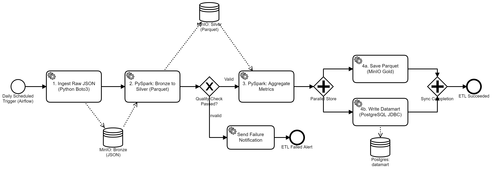

# 👟 Sneaker Lakehouse | End-to-End Batch Data Platform

[](https://airflow.apache.org/)
[](https://spark.apache.org/)
[](https://www.postgresql.org/)
[](https://min.io/)
[](https://www.docker.com/)
[](https://www.python.org/)

An enterprise-grade, reproducible **Medallion Lakehouse (Bronze ➔ Silver ➔ Gold)** batch processing data pipeline built for sneaker e-commerce retail analytics.

Orchestrated by **Apache Airflow**, powered by distributed computations in **PySpark**, backed by **S3-compatible Object Storage** and automated data delivery into an analytical **PostgreSQL Datamart**.

---

## 🏛 Architecture & Pipeline Flow

The entire data workflow follows the **Medallion Lakehouse pattern**, enforcing schema validation, data deduplication, quality checks, and idempotent storage operations at each tier.



```
┌─────────────────┐       ┌────────────────────┐       ┌──────────────────────┐       ┌────────────────────────┐
│  Raw Event Log  │ ───>  │   Bronze Layer     │ ───>  │     Silver Layer     │ ───>  │   Gold Layer & Mart    │
│ (JSON Generator)│       │ (MinIO / S3 Raw)   │       │ (Cleaned Parquet/DS) │       │ (PostgreSQL Datamart)  │
└─────────────────┘       └────────────────────┘       └──────────────────────┘       └────────────────────────┘
                                    │                             │                               │
                               Raw Ingest                  PySpark Cleaning &              PySpark Aggregation &
                              (Boto3 / S3)                   Quality Checks                 Idempotent Upsert
```

### 🔄 Medallion Layers Overview

1. **Bronze (Raw Ingestion Layer):**
   - Ingests raw JSON streaming-style order events (orders, returns, omnichannel touchpoints) partitioned by date `s3://bronze/raw/date=YYYY-MM-DD/`.
   - Preserves source fidelity without schema mutation.
2. **Silver (Validated & Cleansed Tier):**
   - Distributed batch processing using **PySpark**.
   - Validates strict schema, filters anomalous records (invalid prices, non-existent EU sizing), dedupes on `(order_id, event_type)`.
   - Casts timestamps and writes out snappy-compressed **Parquet** partitioned by `order_date`.
   - **Quality Gate:** Automated S3 object contract check verifies partition existence and non-empty state before downstream aggregation.
3. **Gold & Analytical Datamart:**
   - Computes multi-dimensional business KPI aggregations: *Gross Revenue, Refunds, Net Revenue, Purchase Count, Return Rate (%), Average Order Value (AOV)* by `(brand, channel)`.
   - Stores finalized analytics in Gold Parquet and loads into PostgreSQL `datamart.daily_sneaker_brand_metrics`.
   - Idempotent writes: safe task retries without duplicate metric rows.

---

## 💼 Business Impact & Analytical Value

This lakehouse is designed to solve common retail analytics challenges for multi-channel footwear brands:

| Metric | Business Definition | Use Case |
| :--- | :--- | :--- |
| **Gross Revenue** | Total value of generated orders | Track peak sales performance per brand |
| **Refund Amount** | Total volume of processed returns | Identify quality/sizing friction |
| **Net Revenue** | `Gross Revenue - Refund Amount` | Real profitability measure |
| **Return Rate %** | `(Return Count / Total Volume) * 100` | Sizing mismatch detection per sneaker model |
| **Average Order Value**| `Gross Revenue / Purchase Count` | Basket size benchmarking across mobile vs flagship |

---

## 🛠 Tech Stack & Engineering Decisions

| Component | Technology | Rationale & Highlights |
| :--- | :--- | :--- |
| **Orchestrator** | **Apache Airflow 2.9.1** | LocalExecutor DAG scheduling, task retries, alerting callbacks, dynamic execution context. |
| **Processing Engine**| **PySpark 3.5.1 (Java 17)** | High-throughput distributed transformations, dynamic partition overwrite, S3A connector integration. |
| **Data Lake Storage**| **S3-compatible Object Store (RustFS/MinIO)** | S3A file system implementation, multi-bucket medallion storage (`bronze`, `silver`, `gold`). |
| **Analytical DWH**| **PostgreSQL 15** | Dedicated relational datamart database with composite primary key constraints for idempotency. |
| **Infrastructure** | **Docker & Docker Compose** | Isolated microservices stack, automated bootstrapping (`airflow-init`), volume persistence. |
| **Code Quality** | **Python 3.10+** | Decoupled configurations via environment variables, clean typing, strict logging. |

---

## 📂 Project Structure

```bash
sneaker-data-lakehouse/
├── dags/
│   └── sneakers_pipline_dag.py     # Airflow DAG definition & quality check operators
├── scripts/
│   ├── generate_raw_data.py        # Bronze raw event generator & S3 uploader
│   ├── bronze_to_silver.py         # PySpark data cleansing & Parquet partitioning
│   ├── silver_to_gold.py           # PySpark metric aggregation & Postgres datamart loader
│   └── init_buckets.py             # Idempotent S3 bucket initialization (Bronze/Silver/Gold)
├── diagram_1.png                   # High-resolution BPMN architecture diagram
├── diagram_1.bpmn                  # Source BPMN workflow definition
├── docker-compose.yml              # Multi-container orchestration (Airflow, Postgres, S3)
├── Dockerfile.airflow              # Custom Airflow image with Java 17, PySpark & S3A jars
├── init-db.sql                     # PostgreSQL datamart DDL schema & table constraints
├── requirements.txt                # Core Python dependencies
├── .env.example                    # Template for secrets and credentials
└── .gitignore                      # Git exclusion rules for secrets and runtimes
```

---

## 🚀 Quickstart & Reproduction Guide

### Prerequisites
- [Docker](https://docs.docker.com/get-docker/) & [Docker Compose](https://docs.docker.com/compose/) (v2+)
- 4GB+ RAM recommended for local Spark execution

### 1. Clone & Configure Environment

```bash
git clone https://github.com/mihail-grigorev/sneaker-data-lakehouse.git
cd sneaker-data-lakehouse

# Create your local environment file from the template
cp .env.example .env
```

*(All service ports and credentials are safely configurable in `.env`)*

### 2. Launch Services

```bash
docker compose up -d
```

This single command will:
1. Start PostgreSQL 15 and create the `datamart` schema.
2. Spin up S3 Object Storage and create the `bronze`, `silver`, and `gold` buckets.
3. Run database migrations and bootstrap the Airflow webserver and scheduler.

### 3. Access Web Interfaces

- **Airflow Web UI:** [http://localhost:8082](http://localhost:8082)
  - Default user: `admin` / `admin`
- **S3 Object Storage:** [http://localhost:9000](http://localhost:9000) (Console: [http://localhost:9001](http://localhost:9001))
- **PostgreSQL Database:** `localhost:15432` (`airflow` / `airflow`, DB: `datamart`)

---

## 🧪 Pipeline Execution & Testing

### Option A: Trigger via Airflow UI
1. Open [http://localhost:8082](http://localhost:8082).
2. Locate **`sneakers_lakehouse_pipeline`**.
3. Toggle the DAG **On** and click **Trigger DAG (▶)**.

### Option B: Trigger via Airflow CLI
```bash
docker exec de_airflow_webserver airflow dags trigger sneakers_lakehouse_pipeline
```

### Option C: Execute Pipeline Steps Individually

```bash
# 1. Ingest Bronze events for target date
docker exec de_airflow_webserver python3 /opt/airflow/scripts/generate_raw_data.py 2026-10-12

# 2. Run PySpark Bronze -> Silver transformation
docker exec de_airflow_webserver spark-submit --master "local[2]" --driver-memory 1g /opt/airflow/scripts/bronze_to_silver.py 2026-10-12

# 3. Run PySpark Silver -> Gold & Postgres Datamart load
docker exec de_airflow_webserver spark-submit --master "local[2]" --driver-memory 1g /opt/airflow/scripts/silver_to_gold.py 2026-10-12
```

---

## 📊 Verifying Results

### Inspect PostgreSQL Datamart
Run a query against the analytical datamart:

```bash
docker exec -it de_postgres psql -U airflow -d datamart -c "
SELECT 
    order_date, 
    brand, 
    channel, 
    gross_revenue, 
    refund_amount, 
    net_revenue, 
    purchase_count, 
    return_rate_pct 
FROM public.daily_sneaker_brand_metrics 
ORDER BY gross_revenue DESC 
LIMIT 10;
"
```

Sample query output:
```
 order_date |    brand    |     channel     | gross_revenue | refund_amount | net_revenue | purchase_count | return_rate_pct 
------------+-------------+-----------------+---------------+---------------+-------------+----------------+-----------------
 2026-10-12 | New Balance | flagship_retail |     501000.00 |      31500.00 |   469500.00 |             31 |            6.06
 2026-10-12 | New Balance | web_store       |     383500.00 |      88500.00 |   295000.00 |             25 |           16.67
 2026-10-12 | Nike        | web_store       |     341500.00 |      28000.00 |   313500.00 |             23 |            8.00
 2026-10-12 | Adidas      | web_store       |     328500.00 |          0.00 |   328500.00 |             31 |            0.00
```

---

## 🛡 Security & Best Practices

- **Zero Secret Leakage:** No passwords, personal emails, or private access keys are hardcoded in the codebase.
- **Environment Decoupling:** Sensitive configurations are isolated in `.env` (git-ignored) with a documented `.env.example`.
- **Idempotency:** Spark dynamic partition overwrites and PostgreSQL `DELETE before INSERT` logic ensure safe reprocessing without data corruption.
- **Data Quality Assertions:** Pipeline enforces runtime checks prior to committing business-critical metrics.

---

## 🤝 Contact & Contributions

Feel free to open issues or pull requests. For questions or discussions regarding data engineering design choices, connect via GitHub!
